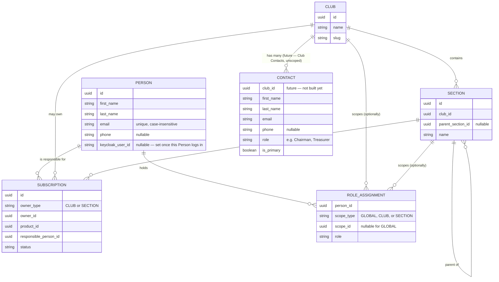
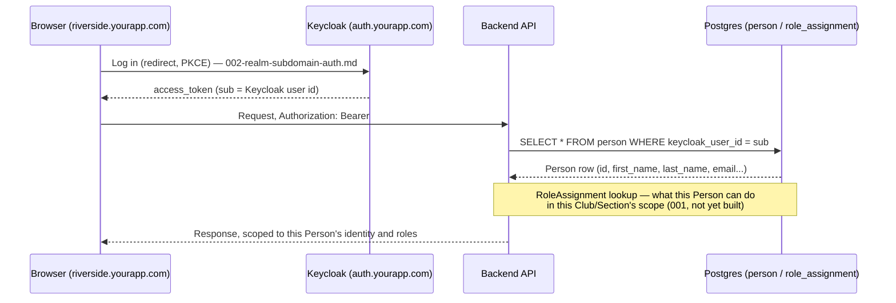
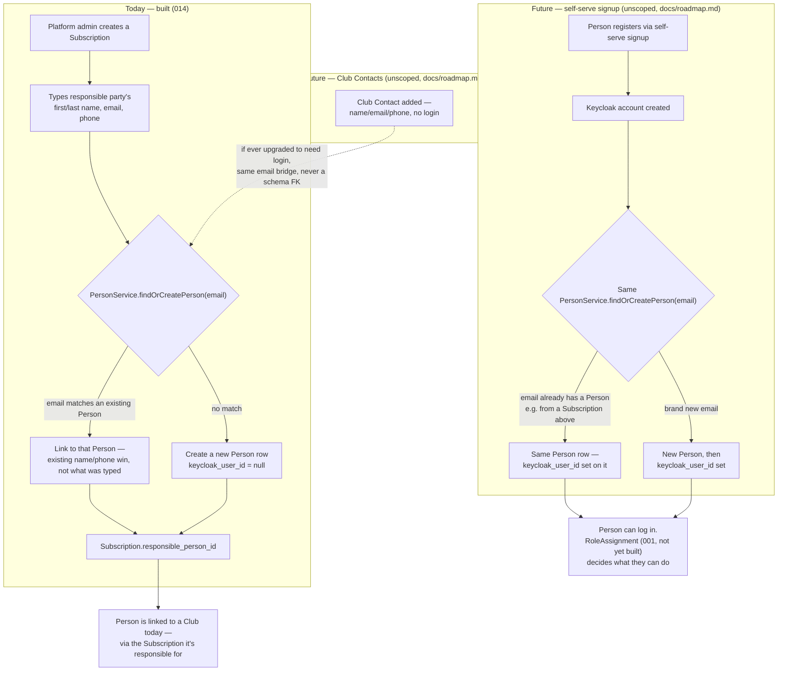
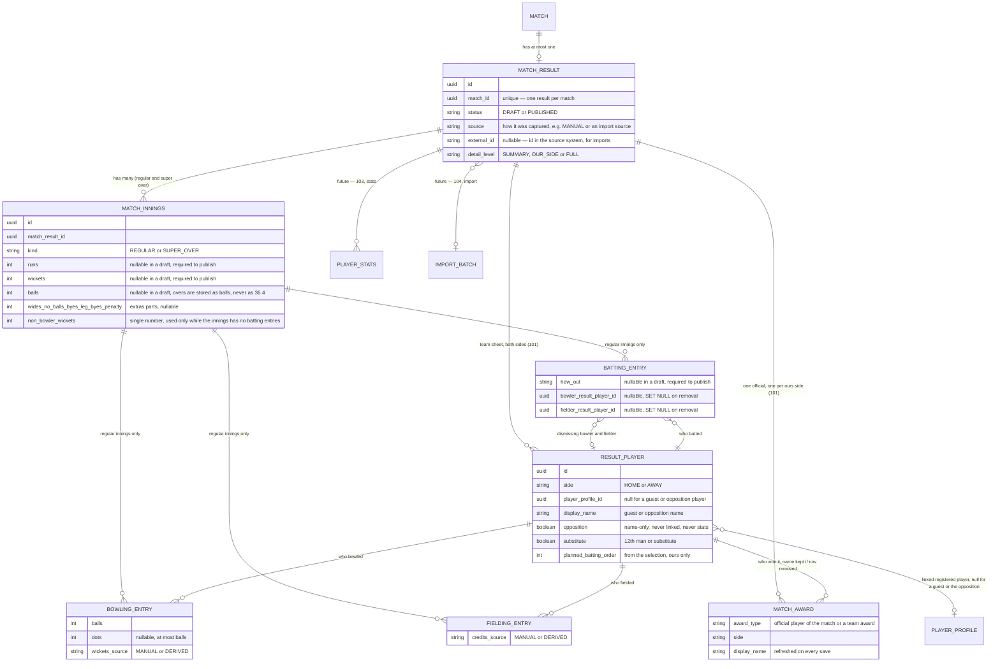

# Architecture — Identity, Tenancy & Auth

A living map of how a human becomes a `Person`, how that `Person` relates to a `Club`, and how login (Keycloak) fits in. Not a spec — it doesn't gate implementation and carries no requirements of its own. Update it whenever a spec changes `Person`/`Contact`/`RoleAssignment`/`Club`/`Subscription`'s shape or relationships, the same living-doc discipline `docs/roadmap.md` already follows. Each diagram notes what's actually built today vs. what a named, still-unscoped future spec owns — don't let this file imply something exists before it does.

## Data model — how the pieces relate

- **`PERSON`** — global, one row per human, forever (`001-tenancy-identity-model.md`). The only entity a Keycloak login ever attaches to.
- **`ROLE_ASSIGNMENT`** — the administrative-capability grant, scoped to `GLOBAL`/`CLUB`/`SECTION`. Named in `001`, **not yet built** anywhere in code.
- **`CONTACT`** — a named point of contact *for a Club* (chairman, treasurer, groundskeeper...), **not built yet** (the "Club Contacts" spec, `docs/roadmap.md`). One `Club` has many `Contact` rows — a real, ordinary foreign key, same shape as `Club` → `Section`. No inherent login capability.
- `SUBSCRIPTION.responsible_person_id` (`014`) is the first real edge from `PERSON` to the rest of the tenancy model — a `Person` gets linked to a `Club` today by being accountable for its `Subscription`, well before any login or role exists.

**The one relationship that's genuinely *not* in this diagram: `Contact` → `Person`.** Unlike `Contact`'s very real FK to `Club` above, it never gets a foreign key to `Person` — that link, when it exists at all, is resolved at runtime by matching email addresses, not stored in the schema. See the flowchart below for exactly how and when that happens.

## Login — resolving a request back to a `Person`

One shared Keycloak realm across every club (`002`) — the subdomain picks which club's data a request is scoped to, not which realm handles the login. `sub` (the Keycloak user id) is the only thing that ever maps to `Person.keycloak_user_id`; nothing else identifies a logged-in human.

## How a human becomes a `Person` — today vs. what's next

**The load-bearing idea:** `PersonService.findOrCreatePerson(email)` is the one resolution point every door into `Person` goes through — a Subscription's responsible party today, self-serve signup tomorrow, a Club Contact's optional login upgrade whenever that's needed. Email is the only key that bridges them; none of these paths ever gain a schema-level FK to each other. A human can arrive at the same `Person` row through any of these doors without the system ever creating a duplicate identity.

**What none of this grants by itself:** a `Person` existing — through any path above — implies zero login and zero administrative capability on its own. Login only exists once `keycloak_user_id` is actually set (self-serve signup, unbuilt). Administrative capability only exists once a `RoleAssignment` row exists (`001`, unbuilt). Both are separate, later, deliberate grants — see `014`'s Non-goals for why this spec stops short of either.

## Match results — how a result hangs off a Match (specs 100 and 101)

- **`MATCH_RESULT`** — one row per `MATCH`, starts as `DRAFT` and becomes `PUBLISHED`. A draft is visible to managers only; every other read goes through `ResultVisibility` (`docs/standards/backend.md`). `source` and `external_id` exist so a later import (104) can find and update the result it created instead of duplicating it. `detail_level` is set by the server from what was captured.
- **`MATCH_INNINGS`** — regular innings and super-over innings share one table, told apart by `kind` (`REGULAR` or `SUPER_OVER`). Overs are balls at the API and in storage; `ui/src/utils/oversFormat.ts` is the only place balls become "36.4". Since 101 it also carries the extras parts and `non_bowler_wickets` (migration 044), and a draft innings may hold only some figures: `runs`, `wickets` and `balls` are nullable (migration 046) because the scorecard is entered before the Scores step; publishing still requires them. Innings are reconciled in place on save, never deleted and recreated, so scorecard rows survive a re-save or a toss-driven resequence.
- **`RESULT_PLAYER`** — "who played", once per side (migration 044). Batting, bowling and fielding rows and awards point at it, so a swap or a link to a registered player is one update. An ours player is either linked to a `PLAYER_PROFILE` or a guest (name only, linkable later); an opposition player (`opposition = true`, migration 045) is a name, a side and an optional substitute marker, never linked and never fed to statistics.
- **`BATTING_ENTRY` / `BOWLING_ENTRY` / `FIELDING_ENTRY`** — rows per regular innings, for both sides. A batting entry names the dismissing bowler and fielder (045); bowler wickets and fielding credits are derived from those dismissals server-side (`DismissalCredits`), marked `DERIVED`, while a `MANUAL` row is never touched. `how_out` is nullable in a draft (migration 047: figures typed before the dismissal is chosen) and enforced at publish. Super-over innings never carry scorecard rows (super-over scorecards are `105`).
- **`MATCH_AWARD`** — one official player of the match plus one team award per ours side; it keeps the name when the player's row is removed (045).
- **Future (not built):** player and team stats (`103`) and results import (`104`) hang off these tables. **Decided order: `104` (import) is built before `103` (stats)**, so real scorecards prove the wizard rules first; see `docs/roadmap.md`.
- **Validation issues** carry a stable `code`, the wizard `step`, the `side` and a `severity`, built on `ResultValidator.WarningCode`/`ErrorCode`.
- **Capture picker gaps:** the awaiting-match picker lacks the team's section on each row and a "show all seasons" toggle.
- Open review questions are listed in `100`'s and `101`'s Rollout Notes.
