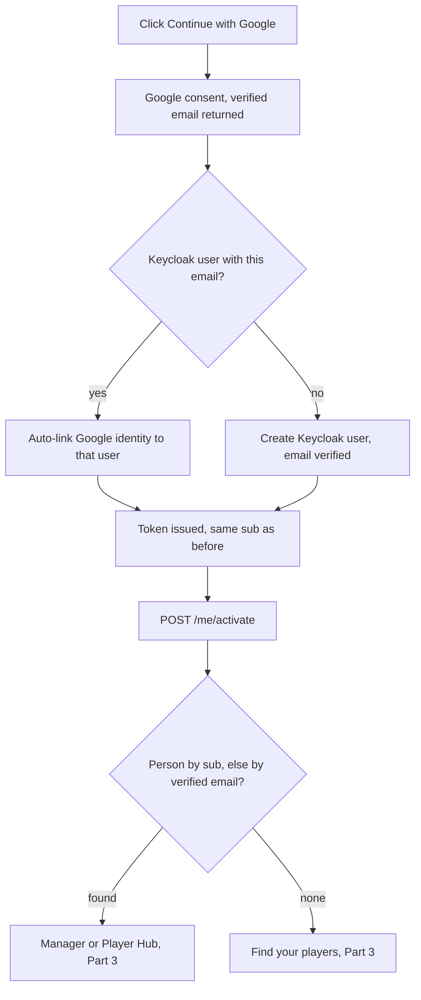
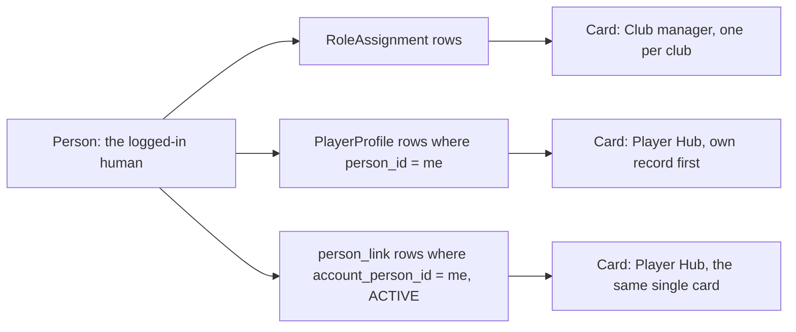

# 119: Login and Account Journey (Keycloak theme, Google sign-in, Access screen, agents and "Player Hub")

**Depends on:** `001-tenancy-identity-model.md` (`Person` is one global identity, `RoleAssignment` is the only authorization, club isolation), `002-realm-subdomain-auth.md` (one shared realm, identity in Keycloak and authorization in the app, per-club subdomains, the session cookie on the auth host; **"External identity providers (Google/Microsoft SSO)" is the item it deferred, and this spec picks it up**), `014-subscription-responsible-contact.md` and `016-keycloak-account-provisioning.md` (`PersonService.findOrCreatePerson`, `KeycloakProvisioningService`, `MeServiceImpl.bridgeByEmail`, the `email_verified` requirement, `POST /me/activate`, `PostLoginRedirect`, `Person.keycloakUserId`; its non-goal "self-serve signup" is what Part 3 now designs), `015-person-status-and-role-assignment.md`, `020-club-manager-access.md` and `035-section-scoped-access.md` (the manager grants and the missing grant/revoke UI that the Managers tab will address later), `017-subscription-welcome-email.md` (`EmailService`, the app's own mail settings, used here for the outcome and invitation emails), `028-players.md` (`PlayerProfile`, its own contact fields kept apart from `Person.email`), `077-public-availability-form-verification.md` (the attempt-and-lockout table, the `source` column on answers, "belonging to the poll"), `088-players-polls-alignment.md` (`verificationStatus`), `079-manager-shell-and-overview.md` (the manager menu and Overview tiles that the Access item lives in), `006-post-login-home-shells.md` (`BottomTabShell` / `PlayerHome`, still a mock), `docs/roadmap.md` ("Player self-registration (follows spec 088)", "Link a new player to an existing person", "Public availability form"), `docs/deployment.md` (Keycloak 24.0.3, realm and client `cricketlegend`, email settings), `docs/standards/*.md`.
**Status:** drafted, defaults accepted 2026-10-23; mockups of the login theme, the Access page's Player accounts tab and the player-matching screens still to do; not yet planned. Written 2026-10-23, simplified the same day by the owner, who then accepted every recommended default (Decisions 13 to 25), decided where the club side lives (Decision 26), settled the matching-screen fields (Decision 28) and the profile chooser's cards (Decision 29). **The Managers tab inside Access is part of the journey but is deliberately kept at high level here: it is to be detailed with the owner in its own pass (slice 3b, Decision 27).** **No open questions remain**; email is already working for testing (Decision 10, Known limitation in Rollout Notes). **The owner is checking the Keycloak realm** to confirm that **Verify email** is set as a required action and that **Google emails arrive verified**; until that check is reported back, both stay a requirement and a checklist item here (Decision 3), not an assumed fact.

## Terminology (binding on the UI copy and this spec)

- **Player**: the person who plays. The UI and this spec never call players "children".
- **Agent**: the account that manages a player. An agent is a parent, a guardian, an agent in the everyday sense, **or the adult player themselves**. The word covers all of them on purpose, so there is one mechanism.
- **Main agent**: the one agent a player has who is in charge of that player's links. **A player has at most one main agent.** Other agents may exist (a second parent); they can see and update the player but cannot hand over or add agents.
- **Manager**: a person with a `RoleAssignment` for a club or section (`015`, `035`). Unrelated to "agent".
- **Profile**: one card on the chooser: "Manager of Riverside" (one per club) or "Player Hub" (one in total, Decision 29). Most people have exactly one.
- **Access** (manager side): the Club-menu item (renamed from "Managers", Decision 26) with two tabs, **Managers** and **Player accounts**.

## Decisions

Settled by the owner on 2026-10-23, binding on this spec. Where an older spec disagrees, this list wins. Decisions 1 to 12 are the owner's design; Decisions 13 to 25 are the owner's acceptance of the recommended defaults that were first listed as open questions; Decisions 26 to 29 are the owner's later rulings.

1. **Managers are always created by a Club Admin**, so a manager's `Person` and `RoleAssignment` exist before their first login (`016`, `020`, `035`). Nobody becomes a manager by registering.
2. **Players' agents (parents, guardians, the adult player) self-register**: a Keycloak account plus a `Person` with **no club access at all**. They then confirm or request the players they manage.
3. **Emails are always verified.** A verified email is required for any step that matches or links a player. The owner's Keycloak flow is believed to require it already and **the owner is checking the realm** (Verify email as a required action; Google emails arriving verified). This spec states it as a requirement with a realm checklist (Part 1) and the backend enforces it regardless. Google emails must arrive verified (Part 2).
4. **The v1 flow** (Part 3): on login, if the person has players on record under their verified email and those players have no main agent, they confirm which are theirs and become the main agent; if nothing matches they ask the club; if a player already has a main agent they see a masked contact and can ask the club.
5. **How a player changes agent**: the main agent can hand over to another account or add a second agent from their own screen (one step, by email); the club manager can always reassign (agent unreachable, divorce, lost login) and can remove a link. This works for adults too.
6. **A linked account can only see and update the players linked to it, and availability polls.** Never manager data, never any other player.
7. **One person, several hats.** The chairman of the Vets league is a manager and a player; a manager can also be an agent. **The profile chooser and the "switch profile" item exist only for a person who really has more than one profile card** (Decision 29). Everyone else is never shown them.
8. **An agent who manages several players** (possibly at different clubs) picks which player to view inside "Player Hub". That is a player selector, not a profile switch.
9. **Club approval is a real step**: a manager verifies a link request is valid, then approves or declines; for a player the club does not have yet, the manager creates the player and approves in one go. Approval is server-enforced (an explicit confirm).
10. **Who sends which email (settled).** The **outcome emails** (accepted or declined, with the manager's note) and the **handover invitation** are sent **by the app through the existing `EmailService`** (`017`). **Keycloak sends** verify email, forgot password and the manager invite itself. Both already work today: Keycloak's realm email and the backend's mail settings (`SMTP_HOST`, `SMTP_PORT`, `SMTP_USERNAME`, `SMTP_PASSWORD`, `SMTP_STARTTLS`, `MAIL_FROM_ADDRESS`) point at the owner's Google account SMTP server, which is fine for testing. Moving to a proper provider later is a configuration change only (Known limitation, Rollout Notes). Email is never a blocker: see Decision 13.
11. **Link requests are rate limited; nothing crosses clubs.**
12. **Delivered small first**: theme, Google, then matching/confirm with club approval and "Player Hub", then handover and the profile switcher.
13. **The in-app status is the source of truth; email is an addition (settled).** A request's Accepted or Declined state, a pending invitation and every outcome are shown in the app regardless of email, so a failed or slow email never changes what is true or blocks anyone. The email is a convenience on top; a send failure is logged and leaves `requester_notified_at` empty, never failing the decision itself.
14. **Handover mechanics (owner, accepting the default).** A hand over steps the previous main agent down only when the new agent accepts; the old one stays an ordinary agent unless they ask to be removed. "Add another agent" keeps the main agent. If the main agent leaves while other agents remain, **nobody is promoted automatically**: the club reassigns, or the next verified email match claims main (a player with no main agent is treated as unmanaged).
15. **Masked contact (owner, accepting the default).** The main agent's masked email (first character, three asterisks, the domain, for example `j***@gmail.com`) is shown **only** to a person whose verified email is the one on the player's record (and to managers on the Access screen and the player's Account section, Decision 26). It is never shown from a typed request.
16. **Under-18 email binding (owner, accepting the default; an amendment to `016`).** `bridgeByEmail` **skips a `Person` whose date of birth makes them under 18**, so a parent's login is never bound to a player's record; that login falls through to the match step. A missing date of birth counts as adult, so existing adult players are not locked out. A data check before slice 3 shows how many rows this affects.
17. **No person merge in this spec (owner, accepting the default).** Never merge in the app for now (a platform admin fixes in the database); duplicate hints only; a merge tool is its own spec after real duplicates are seen. Known consequence: an adult confirmed with "Is this you?" under a self-registered `Person`, and a separate club-created player `Person`, stay two rows linked by `person_link`.
18. **No extra date-of-birth challenge on the email match in v1 (owner, accepting the default).** The club typed the email and the flow is one tap. A date-of-birth challenge or a per-club "always review" setting is added later if a club reports a wrong match (Later).
19. **Google-only accounts are allowed (owner, accepting the default).** "Forgot password" adds a password.
20. **Medical aid details (owner, accepting the default):** visible and editable by the main agent and the adult player; **read-only to other agents**.
21. **"Email on record" means a player's contact email** (`PlayerProfile.email`), not club officials' contacts (`ClubContact` and the others).
22. **Per-club login branding is deferred (owner, accepting the default).** Platform branding only now; the hook is documented; revisit when a club asks (`001` ADR-05 limits it to colour, name, logo).
23. **Input border colour `#8A7F5E`** instead of the mockup's `#B9AE8C`, for 3:1 contrast (owner, accepting the default).
24. **No confirmation email before a Google identity links to an existing Keycloak user (owner, accepting the default).** Google verifies the address and the step adds friction for the invited manager; revisit if a second provider is added.
25. **"Remember my choice" on the profile chooser** is a tick, **off by default**, so a chairman is never dropped silently into the wrong profile.
26. **The club-manager side gets its own home: the "Access" item (owner, 2026-10-23).**
    - **Rename** the existing Club-menu item "Managers" (`ui/src/components/ManagerShell/managerNav.ts`: `id: 'managers'`, `label: 'Managers'`, `tileTitle: 'Team Managers & Permissions'`, `to: '/manage/permissions'`) to **"Access"** (new `id: 'access'`; the Overview tile follows, titled "Access"; the route stays `/manage/permissions`; the icon stays `nav/roles-permissions`).
    - **Two tabs:** **Managers** and **Player accounts**.
    - **Player accounts tab:** link requests waiting for approval, with Approve, Decline, and "New player and approve" (Decision 9); who the main agent is for each player; reassign or remove a link, each with an explicit confirm (Decision 5).
    - **Two shortcuts, no duplicated logic:** (a) the Players list gets a small card at the top, "N link requests waiting", with a button to the Access screen on the Player accounts tab, **hidden when there are none**; (b) each player's detail page gets an **Account** section showing the main agent (name and masked email) with **Invite** and **Reassign** buttons. Both shortcuts reuse the same components and endpoints as the Access tab.
    - **No count badge in the menu.** The owner's rule stands: counts live inside pages, a header bell is a later feature.
    - **Phone:** Players stays on the bottom bar; Access is in the Menu sheet, like Managers today.
    - This supersedes the earlier plan of a "Link requests" counter and list on the Players page.
27. **The Managers tab is part of this journey but is detailed later (owner, 2026-10-23).** The "Coming soon" placeholder at `/manage/permissions` becomes the Managers tab of Access. Its design (what is listed, how a manager is added, edited and removed, and the guards) is **to be detailed with the owner in its own pass, as slice 3b**. Until then the existing placeholder content stays inside the Managers tab. This spec records only the intended capabilities (Part 3, "The Managers tab") and carries no data model, API or test detail for them.
28. **The matching screens show first name, surname initial, club, group and birth year (owner, 2026-10-23).** The "Are these your players?" / "Is this you?" screens show, per player: **first name, surname initial, club name, age group or team label and birth year** (for example "Anna N., Riverside CC, U13A, born 2013"). The **full date of birth is never in the matches response**; only the year is, because it helps a parent with several similarly named players tell them apart without exposing a full date. Whether a player counts as an adult for the "Is this you?" wording is decided on the server from the full date of birth and sent as a flag. The **typed request form still collects a full date of birth** (the manager needs it to verify the request).
29. **The profile chooser shows one "Player Hub" card, plus one "Club manager" card per club (owner, 2026-10-23).** Player and agent open the same screen, so the chooser has **one** card for that view, titled **"Player Hub"**, with a small line under the title such as **"Piet Botha and 2 more"** (the first player by the order below, then a count). **Inside Player Hub, the person's own record is listed first in the player picker** (then their linked players). A person who manages two clubs gets **one "Club manager" card per club**; there is **no silent club switching** (each club is a separate card, and choosing one goes to that club). A section manager still gets one card per club, with their sections as the small line ("Juniors and Vets"). The profile list therefore contains **at most one Player Hub profile, plus one manager profile per club** (and the platform admin profile when it applies).
30. **A linked agent can see and change the player's date of birth, with a warning (owner, 2026-10-23).** The main agent, and the adult player on their own record, see the date of birth and age in Player Hub and can edit it; other agents see it read-only. Editing shows an inline warning (it can change which age group and sections the player is eligible for, it is used to confirm identity on availability links, and it applies at every club because the date lives on the shared `Person`) and Save needs an "I understand" tick. The date is accepted only if it is not in the future, not before 1900 and not over 100 years ago. It still never appears on the matching screens or in any response before a link exists (Decision 28). The change is logged by field name only, never the value. This supersedes the earlier "date of birth is not editable by linked accounts" rule.
31. **A link request carries a section so it reaches the right manager (owner, 2026-10-24).** The "No player found" form asks for the club and then the section (for example U15 or Men), with the message below spanning both columns. The section is required when the club has sections and the request is not tied to a player shown by the person's verified email; it is optional in the "Ask the club to help" flow, and the picker is hidden when the club has no sections. A request with a section is visible, and can be decided, only by club-wide admins and by managers who administer that section; the "unresolved requests are for club-wide admins only" rule now applies only to requests with no section. "New player and approve" defaults the new player's section to the request's section. A new migration adds `link_request.section_id`, and `GET /api/v1/me/clubs/{clubId}/sections` lists the sections a requester can pick.

Settled earlier and re-used: **Keycloak proves who someone is, the app's `RoleAssignment` decides what they may do** (`002` ADR-02; nothing here adds a Keycloak role or group); **`email_verified: true` is required before an email binds a login to a `Person`** (`016`); **section scope is a downward closure** (`035`); **a bulk change or import always ends in an explicit server-enforced confirm** (the owner's standing rule, applied to confirming players and approving requests).

## Problem & Goals

Today only people a vendor or Club Admin provisioned can log in. The login page is Keycloak's stock page and looks nothing like the product. Parents and players have no account and use the shared, unauthenticated availability link (`077`) and nothing else. The app also assumes one login equals one role: `PostLoginRedirect` sends a login to `/admin`, `/manage` or a "Not authorized" dead end.

This spec designs the journey in independently shippable slices: a branded login (Part 1), Google sign-in (Part 2), and a deliberately small agent model (Part 3): log in, confirm the players the club already has under your email, or ask the club, with the club's side of that living in one place in the manager menu (Access).

Goals:
- **A. A login that looks like the product, phone first**: the owner's mockup made responsive, on every Keycloak page, no new UI framework, no third-party calls.
- **B. "Continue with Google"** that lands on the right existing account, never creates a duplicate human and never gives a stranger a manager view.
- **C. Agents find their players with one confirmation** when the club already holds their verified email, and otherwise ask the club, without anyone learning about players they should not.
- **D. A linked account is confined** to its players and their availability polls.
- **E. No change to authorization semantics**: `RoleAssignment` keeps its meaning; links are a separate, narrower grant no manager endpoint reads.
- **F. One home for the club side**: Access holds the Managers tab (detailed later) and Player accounts (requests and main agents), with two small shortcuts and no second implementation.
- **G. Every awkward case in the agent journey has a stated rule** (Scenarios).

## Non-goals

- **No change to `RoleAssignment`, `AccessService`, section closure or `SecurityConfig`.** A link never creates a `RoleAssignment`.
- **No detailed design of the Managers tab in this pass** (Decision 27). Its capabilities are listed as intended, not decided; detail, data model, API and tests come with the later pass.
- **No manager self-registration or "request manager access" button** (Decision 1). A registered account wanting manager access asks its Club Admin.
- **No count badge in the menu or bottom bar** for link requests (Decision 26); the count is inside the Players card and the Access tab only. No header bell.
- **No agent accounts with consent links, no club-recorded consent, no adult-consent route, no consent paperwork of any kind.** Verified email plus club approval is the whole v1 control. Listed under Later.
- **No master/second-guardian machinery beyond one main agent** (Decision 5): no multiple masters, no permission tiers among agents, no approval chain between agents.
- **No age-based behaviour, except Decision 16** (and the adult wording flag of Decision 28): there is no special handling of a player turning 18, no guardian-to-adult hand-over flow and no re-collection of consent. An adult player is simply their own agent ("Is this you?").
- **No merging of `Person` rows**, in-club or cross-club (Decision 17).
- **No second identity provider and no phone/SMS login.** Google only.
- **No per-club branded login**, only a documented hook (Part 1, Decision 22).
- **No change to `theme.ts`, to the Keycloak account console or admin console themes, or to Keycloak email templates** (a branded email theme is a follow-up). Password and session management uses Keycloak's account console, linked from the Profile menu.
- **No new notification system and no new email infrastructure.** The only emails this spec adds are the accepted/declined email and the handover invitation, through the existing `EmailService` (`017`) and its existing mail settings (Decision 10). The in-app status is the source of truth (Decision 13).
- **No account deletion or data export** (separate privacy spec).
- **No public self-registration of a new club.** Club onboarding stays vendor-assisted (`003`, `011`).
- **No change to the shared availability link** (`077`); a linked account simply has a second, authenticated way in.
- **No results, statistics, selection or squad data for linked accounts** (Decision 6). Wider read access is a later, separate decision.
- **No rewrite of the `/player` mock shell (`006`).**

## User Stories

Part 1 (theme)
- As anyone signing in, I see a Cricket Legend page on my phone, with big touch targets and no sideways scrolling.
- As someone who forgot their password, I reset it on a page that looks the same.
- As someone using a screen reader or high contrast, I can read and operate every login page.
- As a platform admin, I can ship a theme change without touching the Keycloak image or the app's deployment.

Part 2 (Google)
- As a manager my Club Admin invited, I can sign in with the Google account that uses the same email and land in the account I already have.
- As a stranger signing in with Google, I never see manager screens and I am told how to find Player Hub.

Part 3 (agents and player accounts)
- As a parent whose email the club holds, I log in and am shown Player Hub with a tick on each (name, club, group and birth year), so one tap confirms they are mine and I become their main agent.
- As an adult player whose email the club holds, I am asked "Is this you?" and confirming makes me my own main agent.
- As a parent whose email the club does not hold, I enter my player's name, surname, full date of birth and club and ask the club to link us.
- As a parent whose player already has a main agent, I see a masked contact (for example `j***@gmail.com`) and can ask the club to help.
- As an agent with several players, possibly at different clubs, I choose which player I am looking at, with my own record first if I have one.
- As an agent, I see and update my player's details and answer availability polls, and I can see nothing else.
- As a main agent, I hand over to another account, or add a second agent, by typing an email.
- As a manager, I open **Access, Player accounts** and see the link requests waiting; I verify each is valid and approve or decline; for a new player I create the player and approve in one go.
- As a manager on the Players list, I see "N link requests waiting" with a button that takes me straight to that tab, and nothing when there are none.
- As a manager, I see on a player's page who the main agent is (name and masked email) and can invite or reassign from there.
- As a manager, I reassign the main agent or remove a link at any time (agent unreachable, divorce, lost login), with a confirm.
- As a requester, I am told by email and in the app that my request was accepted or declined.
- As a chairman who is also a player, I choose between "Club manager" and "Player Hub" after login and switch from the Profile menu; as someone with one card I never see a chooser.
- As someone who manages two clubs, I see one "Club manager" card per club and choose which to open.

## Part 1: The Keycloak login theme (slice 1, no behaviour change)

### What it is

A Keycloak **login theme** named `cricketlegend`: CSS and a few FreeMarker (`.ftl`) overrides on top of Keycloak's standard login theme. **Not** a new UI framework: no React, no build step beyond copying files, no Tailwind, no MUI. (CLAUDE.md's "MUI only" governs the app; a server-rendered Keycloak page cannot use it, so the theme is plain CSS with variables, a recorded exception that adds no dependency.)

- **Parent theme:** `parent=keycloak` in `theme.properties` (Keycloak 24's login theme). We override the minimum: `template.ftl` (page frame, brand mark, background), `login.ftl` (the sign-in card), and where the card is not enough `login-reset-password.ftl`, `login-update-password.ftl`, `login-verify-email.ftl`, `error.ftl`, `info.ftl`, `login-config-totp.ftl`, `login-otp.ftl`, `login-update-profile.ftl`, `login-page-expired.ftl`, `register.ftl`. Every other page inherits the parent's markup and gets the look from CSS alone, so a Keycloak upgrade that changes an untouched template keeps working.
- **Why not just CSS:** the mockup needs the brand mark above the card, a heading ("Walk out to the middle") that is not the realm name, and the "or" divider before the social button. Those are markup. Everything else is CSS.

### Layout in the repository

A new top-level folder beside `backend/` and `ui/` (a repository-layout change; `CLAUDE.md`'s layout block is updated in the same PR):

```
keycloak/
  themes/cricketlegend/login/
    theme.properties            # parent=keycloak, styles=css/cricketlegend.css, locales=en
    template.ftl  login.ftl  ...        # the overrides listed above
    resources/
      css/cricketlegend.css     # tokens + layout + every page
      fonts/                    # BarlowCondensed-600/700.woff2, Inter-400/500/600.woff2 (OFL)
      img/                      # mark.svg (the bat-and-ball logo from the mockup), google.svg, favicon
    messages/messages_en.properties   # "Walk out to the middle", button and link labels
  README.md                     # how to run and develop locally
```

### Visual design, adapted from the mockup

The mockup is a fixed 1280 x 800 canvas with absolutely positioned circles. The theme keeps the look and drops the fixed pixels.

| Mockup element | Theme behaviour |
|---|---|
| Background `#0B3D26` with ovals `#0F5132`, `#14633F`, a cream pitch strip `#E2D5B0`, four gold dots `#E8B83D` | Pure CSS on `body`: layered `radial-gradient`s and one pseudo-element, sized with `vw`/`vh` and `clamp()`. The four gold dots show from 768 px up. All decoration, `aria-hidden`, no content. |
| "CRICKET LEGEND" mark (inline SVG) + Barlow Condensed 700 wordmark | `mark.svg` inline via the template + text in the wordmark font. 44 px mark and 24 px wordmark on phones; 60 px and 30 px from 768 px up. |
| Cream card `#F7F3E8`, 18 px radius, 36 px padding, fixed 400 px | `width: min(100% - 32px, 440px)`; padding 24 px on phones, 36 px from 480 px; the card scrolls with the page so the on-screen keyboard never hides Sign in. |
| Heading, Barlow Condensed 700, 34 px | `clamp(28px, 6vw, 34px)`. Other pages ("Forgot your password?", "Update password") use the same style with their own text. |
| Inputs 48 px, 1.5 px border, 10 px radius, 16 px text | Same. 16 px is kept deliberately (below it iOS zooms on focus). **Border colour changes** (Accessibility, Decision 23). |
| Sign in: gold, dark-green text, 52 px, fully rounded | Same, full width; disabled while submitting. |
| "or" divider, then "Continue with Google" (white, outlined) | Rendered **only when the realm has a social provider enabled** (`social.providers??`), so slice 1 ships without it and slice 2 only turns the provider on. Local `google.svg`. |
| Remember me, Forgot password? | Rendered by Keycloak only when the realm enables them. |
| "New here? Create an account" | Rendered only when `registrationAllowed` is on (slice 3). Slice 1 shows nothing. |

Tokens are CSS custom properties at the top of `cricketlegend.css` (`--cl-green-900: #0B3D26`, `--cl-green-800: #0F5132`, `--cl-green-700: #14633F`, `--cl-gold: #E8B83D`, `--cl-cream: #F7F3E8`, `--cl-sand: #E2D5B0`, `--cl-red: #C8102E`, font stacks, radii). They mirror the mockup and the app's brand; they are **not** read from `theme.ts` (Keycloak cannot import the app bundle). `docs/standards/design-system.md` gets one line: the theme's token block is a deliberate copy, updated when brand tokens change.

### Pages covered

| Page | Template | Notes |
|---|---|---|
| Sign in | `login.ftl` | the mockup |
| Forgot password; "email sent" | `login-reset-password.ftl`, `info.ftl` | |
| Set / update password | `login-update-password.ftl` | shows the realm password-policy text |
| Verify email (required action and "check your inbox") | `login-verify-email.ftl`, `info.ftl` | the page an invited manager and every new agent lands on |
| Update profile, terms, other required actions | `login-update-profile.ftl`, inherited | |
| Error, expired page, "already logged in" | `error.ftl`, `login-page-expired.ftl`, `info.ftl` | friendly wording from `messages_en.properties`, a "Back to Cricket Legend" link from `client.baseUrl` |
| Two-factor setup and entry, recovery codes | `login-config-totp.ftl`, `login-otp.ftl` | **styled but not enabled**; turning it on later is a settings change |
| Registration | `register.ftl` | styled in slice 1; reachable only after slice 3 enables registration |
| Identity-provider pages | inherited, CSS only | reachable from slice 2 |
| Logout confirmation | `logout-confirm.ftl` | inherited, CSS only |

### Fonts and third-party calls

Barlow Condensed (600, 700) and Inter (400, 500, 600) ship as **self-hosted `woff2`** under `resources/fonts/` with `@font-face`, `font-display: swap` and Latin `unicode-range`, so the pages make **no request to Google Fonts or any CDN**. The mockup's `fonts.googleapis.com` link is removed. Both fonts are SIL OFL; licence texts sit next to the files. No analytics, tracking pixel or third-party script; the only network calls go to the auth host. (Google's sign-in redirect in Part 2 is a deliberate user action.)

### Mobile-first and accessibility

- **Mobile first:** the base CSS is the phone layout (single column, 16 px gutters, 48 px+ targets, full-width social button); wider layouts use `min-width` queries at the project breakpoints (`docs/standards/design-system.md`). No horizontal scroll at 320 px.
- **Text size:** `rem` units; works at 200% zoom without clipping.
- **Contrast (WCAG 2.1 AA):** dark green `#0B3D26` on gold `#E8B83D` about 7:1; `#0B3D26`/`#0F5132` on cream above 8:1; muted `#3F5448` on cream about 7:1; cream wordmark on dark green far above 4.5:1. **The mockup's input border `#B9AE8C` on white is about 2.2:1 and fails the 3:1 needed for a control's edge** (WCAG 1.4.11). The theme uses `#8A7F5E` (about 3.6:1 on cream, 4:1 on white) for input and outlined-button borders (Decision 23).
- **Focus:** a visible 3 px gold focus ring with a dark offset on every control; tab order follows the visual order; the Remember me / Forgot password row wraps rather than overlaps.
- **Forms:** real `<label for>`; errors tied to the field with `aria-describedby`, in an `aria-live="polite"` region, never colour alone; `autocomplete` set so password managers work; the show-password toggle has an accessible name.
- **Motion:** only the button colour transition, disabled under `prefers-reduced-motion`.
- **Language:** `lang` from the realm locale; `locales=en` now, messages file structured for an Afrikaans file later.

### Per-club branding hook (documented, not built)

Platform branding now (Decision 22). For later: the SPA adds a `club=<slug>` parameter to the login URL (`ui/src/auth/keycloak.ts`); the theme reads it and applies the club's colour, name and logo through the same CSS custom properties, sourced from the existing `GET /api/v1/public/branding?slug=` (`001`). Constraints for that later spec: the fixed token set only (`001` ADR-05), fallback to platform branding for an unknown slug, no club data beyond what `/public/branding` exposes. This spec ships none of it.

### Packaging, deployment, local development

- **Packaging:** the folder `keycloak/themes/cricketlegend/`, copied to `/opt/keycloak/themes/cricketlegend/` (a `COPY` in the Keycloak image build or a bind-mounted volume). A CI step zips the folder as the standard theme artifact, so a deploy is "drop the artifact, restart or let the cache expire". No dependency on the backend or UI release.
- **Local development** (`quay.io/keycloak/keycloak:24.0.3`, container `cricketlegend-keycloak-dev`, `auth.localhost:8180`): bind-mount the folder and switch off theme caching.

  ```
  -v "$PWD/keycloak/themes/cricketlegend:/opt/keycloak/themes/cricketlegend"
  start-dev --spi-theme-static-max-age=-1 --spi-theme-cache-themes=false --spi-theme-cache-templates=false
  ```

  `docs/deployment.md` records that the container was created by a bare `docker run` with no volume; the README documents the full command and provides a `docker-compose.keycloak.yml` (same image and port, mounted theme, named volume for realm data). No application code changes.
- **Realm checklist** (recorded in `docs/deployment.md`, per environment, done by hand; **verify each against the real realm, do not assume**; the owner is currently checking the first three rows):

  | Setting | Value | Why |
  |---|---|---|
  | Authentication, Required actions: **Verify Email** | **Enabled as a required action (Decision 3).** Owner is checking. | `email_verified` is what the backend trusts; every agent and invited manager verifies before login completes |
  | Login, **Verify email** | **On.** Owner is checking. | the same requirement, as the realm login setting |
  | Identity provider Google, **Trust Email** | On, and a Google login arrives with `email_verified: true` (Part 2). Owner is checking. | satisfies Decision 3 for Google users |
  | Themes, Login theme | `cricketlegend` | uses the theme |
  | Login, Remember me | On | the mockup's checkbox |
  | Login, Forgot password | On | email is already configured (Google account SMTP for testing) |
  | Login, Login with email | On | "Username or email" |
  | Login, Edit username | Off | email is the identity |
  | Login, Duplicate emails | **Off** | one Keycloak user per email; the foundation of bridge-by-email |
  | Login, User registration | **Off in slices 1 and 2, On in slice 3** | the "Create an account" link |
  | Sessions: SSO idle / max, Remember-me idle / max | per environment (suggest 30 min / 10 h; 30 days with Remember me) | makes the checkbox mean something |
  | Security defenses, Brute force detection | On | the login page is now a public face |
  | Email (SMTP) | already configured (Google account SMTP, for testing; see Known limitation in Rollout Notes) | verify email, forgot password and the manager invite are sent by Keycloak |

### Out of scope for Part 1

Branded Keycloak emails (`016` non-goal stands), the account console look, Afrikaans, per-club login branding.

## Part 2: Google sign-in through Keycloak identity brokering (slice 2)

### Principle

The app never talks to Google. Keycloak is the broker: the user clicks "Continue with Google" on the Keycloak page, Keycloak redirects to Google and back, then issues the same kind of token it always has. The backend sees an ordinary JWT (`sub`, `email`, `email_verified`, `name`); **no backend code is needed for Google itself**. What changes is how that JWT resolves to a `Person` and what happens when it resolves to none.

### Realm configuration (manual, recorded in `docs/deployment.md`)

1. **Google Cloud console:** an OAuth 2.0 client (Web application), "Cricket Legend", **Authorized redirect URI** exactly `https://auth.<root-domain>/realms/cricketlegend/broker/google/endpoint` (locally `http://auth.localhost:8180/realms/cricketlegend/broker/google/endpoint`; one Google client per environment). No JavaScript origins needed. The consent screen needs the app name, privacy-policy and terms URLs, so the privacy policy must exist before production use (deployment prerequisite). Scopes: `openid email profile` only.
2. **Keycloak, Identity providers, Google:** client id and secret from step 1; **Trust Email: On** (Google asserts `email_verified`; Keycloak copies the flag onto the brokered user, which is what `bridgeByEmail` demands, satisfying Decision 3 for Google users; the owner is confirming this in the realm); Sync mode Import; Hosted domain empty; Store tokens Off.
3. **SPA redirect URIs are unchanged.** Google redirects only to the auth host's `broker/google/endpoint`; Keycloak then redirects to the SPA's already-registered per-club redirect URI (`002` ADR-03 as implemented by `registerClubRedirectAccess`).
4. **A dedicated first-broker-login flow**, `first broker login - link by verified email`, copied from the built-in flow and set as the provider's "First login flow":

   | Step | Requirement | Behaviour |
   |---|---|---|
   | Review Profile | **Disabled** | Google supplied name and verified email; a review page adds friction and a place to change the email |
   | Create User If Unique | Alternative | no Keycloak user with this email: create one |
   | Handle Existing Account (sub-flow) | Alternative | a Keycloak user with this email exists |
   | , Detect Existing Broker User | Required | |
   | , **Automatically Set Existing User** | Required | links the Google identity to the existing user, only because Trust Email is on and Google's email is verified. The built-in "Confirm Link Existing Account" and "Verify Existing Account by Email" steps are removed (Decision 24). |

   This is the one place the platform accepts "Google says this address is theirs": the same trust the backend already places in `email_verified`, extended to a second issuer. Risks and limits are in Security.
5. **Mappers:** default Google mappers (email, first name, last name). No role or group mapper (`002` ADR-02): nothing Google says can grant access.

### What a Google login produces



- **Invited manager signing in with Google for the first time** (same address): the identity links to the invited Keycloak user (the one `016` created with `UPDATE_PASSWORD` + `VERIFY_EMAIL`); the `sub` is that user's; `bridgeByEmail` binds the `PENDING` `Person`, flips it `ACTIVE`, and the manager lands in `/manage`. Both password and Google now work.
- **Existing password user:** same link on first Google use; no second account or `Person`.
- **Google user with a different email than the club holds:** a new Keycloak user and no `Person`. The result is the "no Person" case, not a guess at who they are. The way back is a link request (Part 3).
- **Google user with no `Person`** (the common first-time agent): `POST /me/activate` returns `personId: null`. The UI routes to the **Find your players** screen (Part 3), never to `/admin` or `/manage`. Today's `PostLoginRedirect` sends that caller to `/admin`'s "Not authorized"; slice 2 changes that branch to a minimal `/welcome` ("Your account is ready, but it is not linked to a club yet. Managers: ask your Club Admin to add you"), which slice 3 turns into the real screen.
- **Google-only accounts** (no password): permitted (Decision 19); "Forgot password" sets one.

### Failure and edge handling

- **Google email unverified** (rare): the auto-link step is skipped; the user sees Keycloak's themed "an account with this email already exists" page with a sign-in link. The backend would refuse to bind anyway.
- **Cancelled consent or Google error:** themed error page with Back to sign in. **Google outage:** password login unaffected.
- **Two Google accounts, one human:** two Keycloak users; at most one matches the `Person`'s email; the other uses a link request. Not merged.
- **Google email changes later:** the identity is keyed on Google's stable subject id, not the email, so it does not unlink; `Person.email` is never rewritten from a token.

## Part 3: Access, agents and "Player Hub" (slices 3, 3b and 4)

### The model in one picture

`Person` stays the single identity. The app asks "what can this person do, and for whom?" from three sources, computed on read (nothing stores "the user's profiles"):



Two kinds of chooser card only (Decision 29): **Club manager** (one per club) and **Player Hub** (one in total, containing the person's own player record first, if any, and every player they are an agent for). A platform admin keeps today's `/admin` profile.

### The Managers tab (intended, not yet decided; slice 3b; Decision 27)

**To be detailed with the owner in its own pass.** The existing "Coming soon" placeholder content (the "Team Managers & Permissions" `EmptyState` at `/manage/permissions`) **stays in the Managers tab until then**; slice 3 only moves it under the new tab strip. What is intended, with nothing below decided:

- **List** managers: name, email, role and scope, and whether the person is Pending (not yet logged in) or Active.
- **Add manager** by name and email: reuse the `Person` by email (never a second identity, `014`/`016`), create the `RoleAssignment`, and provision a Keycloak account and invite through the existing `KeycloakProvisioningService` (`016`); the manager exists before first login and the first login links by verified email. Keycloak sends the invite itself (Decision 10), so this works today with the existing email setup.
- **Edit permissions** (change role or scope).
- **Remove** a manager's access with a confirm; the `Person` is never deleted (they may still be a player or an agent, the chairman case).
- **Last-admin guard**: a club always keeps at least one Club Admin, and a manager cannot remove their own last admin role.
- **Section scope**: section-scoped admins manage only within their own sections (`035`).
- All of it server-enforced and confirm-gated, per the owner's standing rule.

Data model, API, UI detail, tests, acceptance criteria and the exact rules (which roles and scopes are offered, what counts toward the last-admin guard, who may manage whom) are **not specified here**; they are part of the later pass. Nothing in the agent journey below depends on them, except that a manager added there can also be a player or an agent, which is the multi-card case (Decision 7) the profile switcher already covers.

### The v1 flow for agents (Decision 4)

Runs on login, after `POST /me/activate`, for any person with a **verified email** and **no linked players yet** (and again from "Find Player Hub" in Player Hub). An unverified email stops here with "Verify your email to continue" (Keycloak should never let it through; the backend refuses regardless).

1. **Look up players on record under the verified login email.** The server finds active, verified `PlayerProfile` rows whose `email` equals the verified login email (case-insensitive), **across all clubs** (siblings sharing a parent's email, players at several clubs). The caller must not already hold an `ACTIVE` link to them. Each result shows only the minimum (Decision 28): **first name, surname initial, club name, age group or team label and birth year**. **No full date of birth**, phone, address, medical or photo.
   - **Players with no main agent**: all **pre-ticked**. Heading **"Are these your players?"**; for a single adult player whose record matches, **"Is this you?"** (an adult is any player whose date of birth makes them 18 or over, decided on the server and sent as a flag; no date of birth counts as not adult, so the plural wording is used). The user unticks any that are not theirs and presses **Confirm**. Confirming creates an `ACTIVE` `person_link` for each ticked player with `is_main = true`, `granted_via = EMAIL_MATCH`, `granted_by_person_id` null (the system, on the strength of the verified email). **The server requires an explicit `confirm: true` and only for the references the user sent.**
   - **Players that already have a main agent**: listed separately and not ticked. See step 3.
2. **No player's email matches**: show **"No player found"** and a short form: the player's **first name, surname, full date of birth and club** (a picker of clubs on the platform by name; the form never confirms whether a player exists) and an optional message. Submitting creates a **link request** (below). The reply is always the same, "Thanks, the club will review this", whether or not a player matches (no enumeration). The requester then sees the request as "Waiting for <club>" in Player Hub, and its outcome when decided.
3. **A player already has a main agent**: show **"Contact the main agent"** with only a **masked email** (for example `j***@gmail.com`: first character, three asterisks, the domain) and **"Ask the club to help"**, which creates a link request for that player at that club (same screen as step 2, pre-filled). The masked address is shown only because the caller's verified email is the one the club holds for this player; it is never shown from a typed request (Decision 15).

**Why a verified email match is enough to create a link without a club decision:** the club typed that email itself as the contact for this player, and the person has just proved they control it. Everything weaker (a different email, a typed name and date of birth, a player already managed by someone else) is a request a human at the club decides. There is deliberately no extra date-of-birth challenge in v1 (Decision 18); a per-club "always review" switch is a possible later setting.

### Link requests and club approval (slice 3), on Access, Player accounts

A request is **untrusted input waiting for a human**, never a grant. The manager's queue lives in **Access, Player accounts** (Decision 26) and is reached from the Players-list card or the menu. It shows what the requester typed (including the full date of birth), the verified email of the requester and, at most, a **suggested** match from the club's own players by name and date of birth. The manager **verifies the request is valid** and then:

- **Approve, existing player:** the manager picks the player (or confirms the suggestion). If the player has no main agent the requester becomes the main agent; if one exists the manager chooses between "make main agent (replaces)" and "add as another agent".
- **Approve, new player ("New player and approve"):** creates the `PlayerProfile` (the typed name and date of birth, `VERIFIED` because the manager created it; the manager can edit before saving) **and** approves in one go; the requester becomes the main agent.
- **Decline**, with an optional note shown to the requester.

Approval and decline are server-enforced: `approve` without `confirm: true` is a 400. Section-scoped managers (`035`) see and decide only requests whose suggested or picked player lies in their sections, and see only their sections' players in the main-agent list; a request with no resolved player is visible only to a club-wide admin (the conservative rule `035` applies to untagged resources). Approving writes the `person_link` and closes the request in one transaction (`granted_via = CLUB_APPROVAL`, `granted_by_person_id` = the manager).

**Telling the requester (Decisions 10 and 13).** On approve or decline the app sends an "accepted" or "declined" email (with the note) through the existing `EmailService` (`017`), using the existing mail settings, which already work. The email is sent after the decision is saved; if sending fails it is logged, `requester_notified_at` stays empty and the decision stands. **The in-app status is the source of truth:** Player Hub always shows the request as Accepted or Declined (with the note) and the post-login screen shows a one-line banner; the email is an addition and never a blocker.

### The manager side: Access, shortcuts, one implementation (Decision 26)

- **Access** replaces "Managers" in the Club menu (and its Overview tile). Route `/manage/permissions` stays; the tabs are `/manage/permissions` (Managers, placeholder content until slice 3b) and `/manage/permissions/player-accounts` (Player accounts). The tab is part of the URL so a shortcut can link to it and a refresh keeps it.
- **Player accounts tab**, top to bottom: a counter line "N link requests waiting" (inside the page, not the menu); the **request list** (record cards in the standard list pattern: requester name and verified email, typed player and club, age from the typed date of birth, suggested match, time waiting, Approve / Decline / New player and approve); then **Players and their main agent**, a searchable, filterable list (filters: Section, "No main agent") of the club's players showing the main agent's name and masked email and the number of other agents, with the row actions. Slice 3 ships the lists and the request actions; slice 4 adds the row actions **Invite, Reassign, Remove link** (each confirmed).
- **Shortcut (a), Players list:** a small card at the top, "N link requests waiting", with a button "Review requests" to `/manage/permissions/player-accounts`; **absent when N is 0** (and absent while loading, so it never flashes). N comes from the same `link-requests/summary` endpoint as the tab's counter.
- **Shortcut (b), player detail page:** an **Account** section (a card in the existing detail-page pattern) showing the main agent (name and masked email, or "No main agent"), the number of other agents, and, from slice 4, **Invite** and **Reassign** buttons. It uses the same hooks, dialogs and endpoints as the Access list rows (the row actions and the Account buttons are one shared component, `PlayerAgentActions`), so there is one implementation of invite, reassign and remove.
- **No count badge on the menu item or the bottom bar.** Phone: Players stays on the bottom bar; Access is in the Menu sheet, like Managers.

### Changing agents (slice 4, Decisions 5 and 14)

- **The main agent hands over, or adds a second agent, from their own screen, in one step:** on the player's card, "Hand over" or "Add another agent", then an email address. Add creates an `INVITED` link for that email; **hand over** creates an `INVITED` link flagged `make_main` and, **when it is accepted**, the previous main agent is stepped down in the same transaction (they stay an ordinary agent unless they chose "and remove me"). The invitee accepts by logging in (or registering) with that **verified** email and pressing Accept; an invitation expires after 14 days and can be cancelled by the sender. The app sends the invitation email "<Name> invited you to manage <player> at <club>" through the existing `EmailService` (Decision 10); the invitee also sees the invitation in the app on their next login, so the email is an addition.
- **A second agent can see and update the player and answer polls**, like any linked account, but **cannot hand over, add agents or remove anyone**.
- **The club manager can always reassign:** from the Access list or the player's Account section they see the player's main agent and can remove any link, promote an existing agent to main, or invite an email as main agent (for an unreachable agent, a divorce, a lost login). The change is server-confirmed (`confirm: true`) and logged with who did it. The old agent's access ends at once.
- **A person can leave:** any agent can remove their own link. If the main agent leaves while other agents exist, **nobody is promoted automatically** (Decision 14): the club reassigns, or the next verified email match claims main.
- Works for adult players exactly the same way ("Is this you?" on the first match; an adult may hand their own record to another account or add an agent such as their own representative).

### The profile chooser and switcher (slice 4, Decisions 7, 25 and 29)

Shown **only** when the person has more than one card. One card means straight to its home, exactly as today.

- **The cards (Decision 29):** at most **one "Player Hub" card** (Player and Agent open the same screen), with a small line under the title such as "Piet Botha and 2 more" (the first player in picker order, then a count; a single player shows just the name), and **one "Club manager" card per club** the person manages (a section manager sees their sections as the small line, for example "Juniors and Vets"). A manager of two clubs therefore sees two manager cards and chooses; there is **no silent club switching**. A platform admin keeps the "Platform admin" card.
- **After login:** `/choose-profile` with **big cards**, one per card above, the club name on each manager card; pending items shown as a small chip. A "Remember my choice on this device" tick (**off by default**, Decision 25) stores the last choice locally.
- **Under the Profile menu** in both shells: "Switch profile" lists the same cards; the loaded one is marked and named in the header. A card of the same club swaps the shell in place; one of **another club** navigates to that club's subdomain, where the Keycloak session makes sign-in silent (`002`).
- **Inside Player Hub, the person's own player record is listed first in the player picker**, then their linked players (the order is the same one that decides the card's small line).
- **The hat is not a permission:** the server never reads which card is loaded; every call is authorized from the caller's real rows. A person who is both a manager and an agent can use both namespaces; the card only decides what the UI shows.
- Before slice 4 a person who is a manager and also an agent lands in `/manage` and reaches **Player Hub** from an item in the Profile menu; the chooser itself arrives in slice 4.

### Player Hub (what an agent sees and does, Decision 6)

New namespace `/api/v1/me/players/**`, authenticated, **authorized only from the caller's own `ACTIVE` `person_link` rows** (plus the caller's own verified `PlayerProfile`, for the "myself" case). Inside Player Hub a **player selector** (a row of player chips on a phone, **own record first**) picks the player; the page shows one player at a time.

- **See:** the player's name, photo, age group and team labels, club, jersey number, and the contact and cricket fields they may maintain. **Not shown:** other players, squads, selections, results, statistics, the club's internal notes, anyone else's contact details, other agents' emails (only a count and the names/masked emails of the agents the main agent has added).
- **Update (whitelist):** the player's `phone`, `email`, `altContactName`, `altContactPhone`, photo, batting stance, bowling arm and type, wicket-keeper flag and medical aid fields (**medical aid is editable by the main agent and the adult player, read-only to other agents**, Decision 20). **Not editable:** name, gender, section tags, jersey number, `active`, `verificationStatus`, the club membership number (a change to the name is a request to the club, outside this spec). The date of birth is editable by the main agent and the adult player only, with the warning in Decision 30. Edits set `PlayerProfile.updatedBy` to the account's `Person`, so the manager sees who changed what.
- **Availability polls:** list the open polls the player belongs to (exactly "belonging to the poll" in `077`), show the player's current answers, save answers **through the existing poll answer code, not a copy**, with a new `source = LINKED_ACCOUNT` beside `MANAGER` and `PUBLIC_LINK`. No date-of-birth challenge (the account is authenticated and the link is the proof). A closed poll is 409.
- **My requests:** the caller's pending, accepted and declined link requests and invitations.
- **Never reachable:** every `/api/v1/manage/**` and `/api/v1/platform/**` endpoint. They require `canAdministerClub` / `canAccessClub`, which look only at `RoleAssignment`; a linked-only person has none, so the existing gate refuses. This is **tested exhaustively** (Test Plan).

### Data Model Changes

Reuse, do not redefine: `Person`, `RoleAssignment`, `PlayerProfile` (with `verificationStatus` from `088`), `ClubMembership`, `Club`, `Section`. **`RoleAssignment` is unchanged.** Migration (sketch; the number follows `052`, assigned when the plan is written): `backend/src/main/resources/db/changelog/v1/053-person-links.sql`. Slice 3 writes to `person_link`, `link_request` and `link_attempt`; slice 4 uses the invitation columns. (The Managers tab's data needs, if any, are part of the later pass.) The birth year in the matches response is derived from the existing `person.date_of_birth`; nothing new is stored.

**`person.origin`** (new column, `VARCHAR NOT NULL DEFAULT 'CLUB_CREATED'`, `CHECK IN ('CLUB_CREATED','INVITED','SELF_REGISTERED')`): which route created the row. Existing rows are `CLUB_CREATED`; `016` provisioning is `INVITED`; slice 3 registration is `SELF_REGISTERED`. Used for support and duplicate hints only.

**`person_link`**: "this account is an agent for this player at this club."

| Column | Type | Meaning |
|---|---|---|
| `id` | uuid PK | |
| `account_person_id` | uuid FK `person`, nullable | the agent. Null only while `INVITED` to an email with no account yet. |
| `invited_email` | text, nullable | the verified email that may accept an invitation |
| `subject_person_id` | uuid FK `person`, not null | the player |
| `club_id` | uuid FK `club`, not null | **links are club-scoped**: a link at Riverside says nothing about the same player at another club |
| `status` | `INVITED` \| `ACTIVE` \| `REVOKED` \| `DECLINED` | only `ACTIVE` grants anything |
| `is_main` | boolean | the main agent; **at most one per (`subject_person_id`, `club_id`)** |
| `make_main` | boolean | on an `INVITED` row: becomes main on accept (hand over) |
| `granted_via` | `EMAIL_MATCH` \| `CLUB_APPROVAL` \| `AGENT_INVITE` \| `CLUB_MANAGER` | how it came to exist |
| `granted_by_person_id` | uuid FK `person`, nullable | who granted it: the approving manager, the main agent who invited, null for `EMAIL_MATCH` |
| `created_at`, `decided_at`, `expires_at` (invitations), `revoked_at`, `revoked_by_person_id` | | |

Constraints: partial unique index on (`subject_person_id`, `club_id`) `WHERE is_main AND status = 'ACTIVE'`; `UNIQUE (account_person_id, subject_person_id, club_id) WHERE status IN ('INVITED','ACTIVE')`; `CHECK (account_person_id IS NOT NULL OR invited_email IS NOT NULL)`; `CHECK (account_person_id <> subject_person_id)` (a player who has their own login is their own player profile, not a link; "Is this you?" for a record held under a different `Person` creates a normal link). Indexes on `account_person_id` and on (`subject_person_id`, `club_id`).

**`link_request`** (untrusted input waiting for a human):

| Column | Type | Meaning |
|---|---|---|
| `id` | uuid PK | |
| `account_person_id` | uuid FK, not null | who is asking |
| `club_id` | uuid FK, not null | whose manager decides |
| `typed_first_name`, `typed_last_name`, `typed_date_of_birth` | text / date | what the requester typed (a full date of birth, Decision 28) |
| `target_player_profile_id` | uuid, nullable | set only when the request comes from the "player already has a main agent" screen (the requester was shown that player through their verified email) |
| `message` | text, max 500, nullable | |
| `status` | `PENDING` \| `APPROVED` \| `DECLINED` \| `CANCELLED` | |
| `resolved_subject_person_id` | uuid FK, nullable | set on approve |
| `decided_by_person_id`, `decided_at`, `decision_note` | | |
| `requester_notified_at` | timestamptz, nullable | set when the outcome email was sent; null means no email has gone out (not yet sent, or the send failed); the in-app status is unaffected (Decision 13) |

**`link_attempt`**: rate limiting and lockout, the same pattern as `077`'s `public_availability_attempt` (`account_person_id`, `kind` `CONFIRM` \| `REQUEST` \| `INVITE`, `count`, `window_started_at`, `locked_until`).

**No change** to `ClubContact`, `TeamContact`, `SectionContact`, `LeagueContact`, `SponsorContact` or the embedded `Contact`: those are contacts of club officials and sponsors, not of players' parents. **The "email on record" is `PlayerProfile.email`** (`028`), the player's own contact field, kept apart from `Person.email` (Decision 21).

### API Contract

All new endpoints require authentication; none is under `/api/v1/platform/**`. Controllers follow `docs/standards/backend.md` (controller, service interface and impl, repository, DTO records, mapper); `MeService` is extended, not duplicated. A request from a person whose token has `email_verified` false is refused (403, code `EMAIL_NOT_VERIFIED`) by every endpoint marked "verified email". (Managers-tab endpoints are not specified here, Decision 27.)

| Endpoint | Access | Slice | Purpose |
|---|---|---|---|
| `POST /api/v1/me/activate` | any authenticated | 3 | **Extended, additive**: `MeAccessDto` gains `profiles: ProfileDto[]` and `pendingItems` (own link requests and their outcomes, invitations for this verified email, "players found, waiting to be confirmed"). `profiles` contains **at most one `MY_PLAYERS` profile plus one `MANAGER` profile per club** (and the platform admin profile when it applies), each with `kind`, `title`, a `subtitle` line (for "Player Hub": the first player and a count, such as "Piet Botha and 2 more"; for a manager: the sections, if section-scoped), club (for managers) and `landing`. Existing fields unchanged, so the OpenAPI diff gate passes. Refuses a `SUSPENDED` person with 403. |
| `GET /api/v1/me/profiles` | any authenticated | 4 | The same profile list for the switcher, without the activation side effect. |
| `POST /api/v1/me/register` | verified email | 3 | Creates the self-registered `Person` (`origin = SELF_REGISTERED`, names and email from the token); idempotent. |
| `GET /api/v1/me/player-matches` | verified email | 3 | Step 1 of the flow: the minimised list, split into `withoutMainAgent` and `withMainAgent`. Each entry carries only `ref`, `firstName`, `surnameInitial`, `clubName`, `groupLabel`, **`birthYear`** and an `adult` flag (no full date of birth); `withMainAgent` entries add the masked email and nothing else. |
| `POST /api/v1/me/links` | verified email | 3 | Body `{ playerRefs[], confirm: true }`. Creates main-agent links for the confirmed players with no main agent. `confirm` must be `true` and each ref must come from the caller's own matches, enforced server-side. |
| `POST /api/v1/me/link-requests`, `DELETE /api/v1/me/link-requests/{id}` | verified email; the requester | 3 | Create (always the same reply; body has the full `dateOfBirth`) and cancel a request. |
| `GET /api/v1/me/players`, `GET/PUT /api/v1/me/players/{playerKey}` | the linked account | 3 | The player list (the person's own record first) and one player's read and whitelist update. `playerKey` is the `person_link` id (or `self:<profileId>`), never a raw person id; a key the caller does not hold is **404, not 403**. |
| `GET /api/v1/me/players/{playerKey}/polls`, `PUT .../polls/{pollId}/answers` | the linked account | 3 | Availability through the existing poll-answer service; `source = LINKED_ACCOUNT`. |
| `POST /api/v1/me/players/{playerKey}/agents` | the main agent | 4 | Body `{ email, mode: HANDOVER \| ADD }`. Creates the `INVITED` link and sends the invitation email. |
| `POST /api/v1/me/links/{linkId}/accept`, `.../decline`, `DELETE /api/v1/me/links/{linkId}` | the invited verified email; the sender may cancel; an agent may remove their own link | 4 | Accept, decline, cancel, leave. |
| `GET /api/v1/manage/clubs/{clubId}/link-requests`, `.../summary` | `canAccessClub`; section rule applies | 3 | The request queue (Access, Player accounts) and the count behind the Players-list card and the tab's counter line. |
| `POST /api/v1/manage/clubs/{clubId}/link-requests/{id}/approve` | as above | 3 | Body `{ playerId \| newPlayer, mainAgentMode: MAKE_MAIN \| ADD, confirm: true }`; **`confirm` required, enforced server-side**; creates the link (and the player, for a new one) and sends the outcome email. |
| `POST .../link-requests/{id}/decline` | as above | 3 | Body `{ note? }`; sends the outcome email. |
| `GET /api/v1/manage/clubs/{clubId}/player-accounts` | as above; section rule applies | 3 | The "Players and their main agent" list: player, section, main agent name and **masked** email, other-agent count; filters `sectionId`, `noMainAgent`; searchable, paged. |
| `GET /api/v1/manage/clubs/{clubId}/players/{playerId}/links` | `canAdministerSection` for the player's sections | 3 | The player's agents for the Account section (read only in slice 3). |
| `DELETE .../players/{playerId}/links/{linkId}`, `POST .../links/{linkId}/make-main`, `POST .../players/{playerId}/links` (invite an email as main) | `canAdministerSection` for the player's sections | 4 | Remove, reassign and invite; all require `confirm: true`. Used by both the Access list and the Account section. |

Errors use the existing shapes (`NotFoundException`, `ConflictException`, `ValidationException`); a lockout is 423 as in `077`.

### UI Requirements

Composes from the shared components and standards (`docs/standards/design-system.md`, `frontend.md`); the mandatory record-list pattern (`ListToolbar` + `RecordCard` + `RecordFormScreen`) applies to the request list and the player-accounts list.

**Existing files and components changed (the rename and the shortcuts):**
- `ui/src/components/ManagerShell/managerNav.ts`: the Club-menu entry becomes `id: 'access'`, `label: 'Access'`, `tileTitle: 'Access'` (the old "Team Managers & Permissions" tile title goes), description updated (for example "Managers and player accounts"), `to: '/manage/permissions'` and the icon `nav/roles-permissions` unchanged. No badge or count property is added.
- `ui/src/components/ManagerShell/managerNav.test.ts`: the path-to-id expectations (`'/manage/permissions'` and its sub-path `/manage/permissions/player-accounts` map to `'access'`), the phone menu-sheet expectation and the label assertions are updated; a test asserts the nav model carries no count and that Players stays on the bottom bar while Access is only in the Menu sheet.
- `ui/src/App.tsx`: the `permissions` route, which renders the "Team Managers & Permissions" `EmptyState` today, becomes an `AccessPage` layout with two tab children (`/manage/permissions` Managers, which keeps rendering the existing placeholder `EmptyState`, and `/manage/permissions/player-accounts` Player accounts).
- The Overview tile for Access follows the nav entry (the tiles are generated from the nav model).
- The Players list page (`PlayerList`): the "N link requests waiting" card (shortcut a).
- The player detail page (`PlayerDetailPage`): the **Account** section (shortcut b).

**New (slice 3):** `AccessPage` (tab layout; a tab strip using the app's existing tab pattern, URL-driven), `PlayerAccountsTab` (counter line, request list, players-and-main-agent list), `LinkRequestCard` and the approve / decline dialogs (with the "New player and approve" step), `LinkRequestsWaitingCard` (shortcut a; renders nothing when N is 0), `PlayerAccountSection` (shortcut b, read-only in slice 3), `FindYourPlayersPage` (replaces the minimal `/welcome`: the pre-ticked list showing first name, surname initial, club, group and birth year, "Are these your players?" / "Is this you?", the "No player found" form with a full date of birth, the "Contact the main agent" block with the masked email and "Ask the club to help"), `MyPlayersPage` (`/account`: player selector chips with the own record first, the player's details and edit form, polls, My requests with Accepted / Declined / Waiting states). A `ui/src/api/playerAccountsApi.ts` per-resource file for the manager endpoints and `meApi.ts` extended for the agent ones.

**New (slice 4):** `PlayerAgentActions` (Invite, Reassign, Remove link, each with a confirm; used by the Access list rows and the Account section), the agents list and "Hand over / Add another agent" action on the agent's player card, the invitation banner and accept dialog, `ProfileChooser` (`/choose-profile`), `ProfileCard` (title, small line, club; one "Player Hub" card, one "Club manager" card per club), `ProfileSwitcher` (menu on desktop, bottom sheet on phone) in the Profile menu of both shells. Storybook story and component test for the shared pieces.

**Reused:** `BottomTabShell` (the account shell on a phone), `PageCounters` and `FilterBar`, `RecordCard`, confirm and dialog patterns, `BrandIcon` (40 px and larger only), a `PlayerCard`-style header, `EmptyState`, the poll answer components used by the public form where possible, the existing card and cross-link patterns (the Players-list card uses a filled or outlined button rather than a bare text link, per the cross-link rule).

- **Wording:** the UI says "players" and "agent" and never "child". Plural/singular follows the match ("Are these your players?" / "Is this you?"). The manager side says "link request", "main agent", "Player accounts".
- **Routing:** `PostLoginRedirect` becomes the decision logic: no `Person` or an unlinked verified email goes to `/welcome` (Find your players); one card goes straight to its home (unchanged for today's managers and platform admins); several go to `/choose-profile` (slice 4). `/welcome`, `/account` and `/choose-profile` are added to `AUTH_AWARE_PATH_PREFIXES` in `ui/src/auth/keycloak.ts` (its comment explains why a path loaded directly needs check-sso while `/post-login` must not have it); `/manage/permissions/**` is already covered by the `/manage` prefix. The `/player` mock shell is untouched.
- **Mobile first:** single-column cards and 56 px targets; the selector is a scrolling chip row; the switcher is a bottom sheet; the Access tabs scroll horizontally if they ever need to; wider screens use two columns. Phone navigation: Players on the bottom bar, Access in the Menu sheet.
- **Mockups first:** the login theme (Part 1), Find your players, Player Hub, the Access page's Player accounts tab, the Players-list card and the player Account section are drawn and approved before the slice that builds them (the workflow's design step); the chooser (with the single "Player Hub" card and per-club manager cards), switcher and hand-over step before slice 4; the Managers tab with its own pass. **Still to do.**

### Security and tenancy

- **Verified email everywhere.** Matching, registration, requests, accepting an invitation and the masked-contact reveal all require `email_verified`. The trust anchor is now two issuers (Keycloak, Google through Trust Email).
- **Minimisation and no enumeration.** The matches response contains only first name, surname initial, club, group and **birth year**; **the full date of birth never leaves the server in it** (Decision 28). A typed request and a failed lookup return the same reply whatever the club holds, and the form never says whether a player exists. The masked email is shown only on the verified-email-match path to agents, and to managers (who already hold the full record) as a mask by design on Access and the Account section.
- **Isolation.** A link is club-scoped; every `/me/players/**` query joins through `person_link.club_id` and the player's `PlayerProfile.club_id`; there is no query listing players by name across clubs. The email match is the only cross-club read, limited to rows where the caller's verified email equals the profile email. The manager endpoints are all under `/clubs/{clubId}/` and check the caller's access to that club.
- **The hat is not a permission** (above). The player key is an opaque link id; an unheld key is a 404.
- **Rate limiting (`link_attempt`):** 5 failed confirmations per account per hour then a 1-hour lock (423); 10 link requests per account per day and 3 pending per club; 5 invitations per account per day; a per-client-address limit on top (as `077`). These limits also cap the emails the app can be made to send. Keycloak's brute-force detection covers password guessing.
- **Google auto-link trust.** Auto-linking by email means whoever controls a Google account with that address can sign in as the Keycloak user, including a manager. Accepted because Google verifies the address and that same address is already the key `016` and `bridgeByEmail` rely on; bounded by no unverified emails, Trust Email on for Google only, no other brokered provider without a new review, and logging. A confirmation email before linking is the safer, noisier alternative, declined for now (Decision 24).
- **Players' data.** This is the first feature that gives people outside club staff access to a (possibly young) player's record. A link is created only by a verified-email match to the club's own record or by a manager's approval; every grant is attributable (`granted_via`, `granted_by`); removal is immediate; one agent's contact details are never shown to another. The privacy policy URL (Part 2) must exist before production use.
- **Audit.** Link creation, acceptance, removal, main-agent change, request decisions and linked-account edits are logged at INFO with actor, subject, club and outcome (`013`); the history is the `person_link` / `link_request` timestamps plus `PlayerProfile.updatedBy`. A persisted audit table is a follow-up if needed.
- **Section scope** for managers deciding requests and reassigning: above. **Deactivated accounts:** scenario 12.

### Scenarios

| # | Scenario | Rule | What the person sees |
|---|---|---|---|
| 1 | **Chairman who plays**: Club Admin of the Vets section at Hillcrest CC and a verified player at the same club | One `Person`; two cards (Decision 29) | Chooser (slice 4) with **"Club manager"** (small line: the Vets section) and **"Player Hub"** (small line: their own name first); before slice 4 they land in `/manage` and reach Player Hub from the Profile menu. Either lands correctly; the Profile menu switches without logout. No link needed (it is the same `Person`; their own record is first in the picker). |
| 2 | **Manager who is also an agent** | Manager grant plus an active link | Two cards: "Club manager" and "Player Hub". The manager grant does not widen what Player Hub shows, and a link never widens manager scope. |
| 3 | **Agent with several players, same club** (siblings under one parent email) | Step 1 lists all, all pre-ticked, each with birth year | One confirm links all; a player selector inside Player Hub. One card, so no chooser. |
| 4 | **Players at different clubs** | One link per (player, club); the match step lists the club name on each | The selector shows the club per player; opening one at another club navigates to that club's subdomain (silent sign-in). Still one "Player Hub" card. |
| 5 | **Parent not yet registered** | The club holds the email; no account yet | Registers (or Google) with that verified email, sees the pre-ticked list, confirms. Registering with a different email gives no match: "No player found" and a request. |
| 6 | **Adult player** | Their record's email matches; adult by date of birth (a server-side flag) | "Is this you?"; confirming makes them their own main agent. They can hand over or add an agent like anyone. If their `Person` was bridged by email (a club-created `Person` with that email), they are their own player profile and need no link. |
| 7 | **Two parents, one player** | The first to confirm is main (`is_main`). The other sees "Contact the main agent" with a masked email, or is added by the main agent (one step), or asks the club | Second parent becomes an ordinary agent after accepting. Cannot hand over, add or remove. |
| 8 | **Main agent leaves / unreachable / divorce / lost login** | The club removes the link, promotes another agent, or invites an email as main, from Access or the player's Account section; nobody is promoted automatically (Decision 14) | Old access ends at once; the new main agent sees the player on next login. |
| 9 | **Hand over to someone** | Main agent types an email; on accept the previous main steps down | The invitee gets an email and sees the invitation on login. Until accepted nothing changes. |
| 10 | **Player the club does not have** | Request with name, surname, full date of birth, club; manager picks "New player and approve" | Manager creates the player and approves in one go from Access, Player accounts; the requester becomes main agent and is told by email and in the app. |
| 11 | **Request declined** | Request `DECLINED`, nothing stored about any matched player | "The club could not link this player" plus the note (in the app and by email); can retry (rate limits apply). |
| 12 | **Deactivated account or player** | `SUSPENDED` person: `/me/**` returns 403 and the login is refused by Keycloak if disabled. Suspended or rejected player: the link stays (history) but the player drops out of Player Hub and their endpoints return 404. | Themed error "Your account is disabled, contact your club" / the player's chip is gone. |
| 13 | **Google user with no `Person`, or a different email** | Part 2 | Find your players; never manager screens. A manager who signed in under a different email must ask the Club Admin to correct their record; a link request never grants manager access. |
| 14 | **A player's `Person` carries the agent's email** (the roadmap's silent-reuse risk: `findOrCreatePerson` matched by email) | The agent's login would bind to the player's `Person` by email. Fix (Decision 16): `bridgeByEmail` skips a `Person` under 18 by date of birth; that login falls through to the match step. A one-off data check finds existing rows (Rollout Notes). | The agent lands on the right profile. |
| 15 | **Duplicate emails** | Keycloak "Duplicate emails" is off; two `Person` rows cannot share an email (`ux_person_email_lower`); two `PlayerProfile` rows may share a contact email (siblings) | All matching players are listed together, told apart by group and birth year. |
| 16 | **Pending invitation for an email with no account** | The `INVITED` link waits with `invited_email` | On first verified login with that email the invitation is shown; it expires after 14 days. |
| 17 | **Section-scoped manager** | Sees and decides only requests and players in their sections; an unresolved request is club-wide only (`035`) | Access, Player accounts lists only their sections; the Players-list card counts only what they can decide. |
| 18 | **No requests waiting** | N is 0 | The Players list shows no card; Access, Player accounts shows the empty state and still lists players and their main agents. |
| 19 | **Outcome email fails to send** | The decision is saved first; the failure is logged; `requester_notified_at` stays empty (Decision 13) | The requester still sees Accepted or Declined in the app. |
| 20 | **Manager of two clubs** | Two clubs, two grants | Two cards, "Club manager" and "Club manager" (plus "Player Hub" if applicable); the person chooses; there is no silent switching between clubs. |

(Scenarios for adding, editing and removing managers belong to the Managers-tab pass.)

## Later (moved out of v1, to `docs/roadmap.md` when this spec merges)

The detailed Managers tab (slice 3b: add, edit, remove, guards; "to be detailed with the owner"); `MANAGER`/`PLAYER` role grants and `TEAM`-scope grants if the Managers pass wants them; agent accounts with consent links; club-recorded consent; an adult-consent route; multiple main agents or permission tiers among agents; any age-based hand-over when a player turns 18; per-club "always review" and "auto-approve" settings and a date-of-birth challenge on the email match (Decision 18); a person-merge tool (Decision 17; the roadmap's duplicates design); a persisted audit table; a header bell for outcomes (and so any count indicator outside the pages themselves); wider read access for linked accounts (own results and statistics); branded Keycloak emails; per-club login branding (Decision 22); an Afrikaans locale; account deletion and data export; moving email to a proper transactional provider (Known limitation).

## Test Plan

Per `docs/standards/testing.md`. Tests belong to the slice that builds the behaviour. (The Managers tab's tests are part of its later pass.)

**Slice 1 (theme)** has no unit or integration tier (no code). Required instead:
- **Manual checklist per theme release**, on a phone-size and a desktop viewport, with forced-colors and 200% zoom: every page in "Pages covered" renders (sign in, wrong password, forgot password and its confirmation, reset link and update password, verify email, expired page, error, "already authenticated", logout confirm); no horizontal scroll at 320 px; keyboard path (tab order, visible focus, Enter submits); a screen reader reads labels and errors; contrast spot-check of border, link and button colours; **zero requests to any host other than the auth host** (network panel); a password manager fills the form; Remember me, Forgot password, the Google divider and the registration link appear and disappear with the realm toggles; **the realm checklist is verified, including Verify Email as a required action and Verify email on** (the owner's realm check feeds this).
- **One Playwright check** (desktop and mobile viewport): the login page shows the brand heading and makes no external requests (route-intercept). Not in CI (needs the dev Keycloak), same precedent as `016`.

**Slice 2 (Google)**
- Component: `PostLoginRedirect` no-profile branch goes to `/welcome`, not `/admin`.
- Unit/integration: `MeServiceImplTest`: a verified email matching a `PENDING` manager `Person` binds and activates; an unverified email binds nothing; no matching `Person` returns `personId: null`.
- Manual, against a local Keycloak with a test Google client: Google user with an invited manager's email (links, lands in `/manage`, one Keycloak user); unknown email (Find your players, never `/manage` or `/admin`); existing password account (same `sub`); cancelled consent; unverified Google email; **a Google login arrives with `email_verified: true`**.

**Slice 3 (match, confirm, requests, Access tabs, Player Hub)**
- Unit (backend): `LinkService`: matches only from a verified email (unverified refused everywhere); results minimised to first name, surname initial, club, group, **birth year** and the `adult` flag, and split by main-agent presence; **the full date of birth is not in the response, and `birthYear` equals the year of the stored date**; `confirm: false` or a ref not among the caller's matches is refused; confirmed players get `is_main` links; a player with a main agent is never linked here; masked email format and that it is never returned for a typed request; request replies identical for matched and unmatched; the typed request stores the full date of birth; rate limits and 423; approve needs `confirm: true`; approve "new player" creates a `VERIFIED` profile and the main-agent link in one transaction; decline stores the note; a section-scoped manager cannot see or decide an out-of-section or unresolved request, and `summary` and `player-accounts` count and list only their sections; the outcome email goes through `EmailService` after the decision is saved, sets `requester_notified_at` on success, and a thrown send failure is caught and logged without undoing the decision (mocked `EmailService`); `bridgeByEmail` skips an under-18 `Person` and treats a missing date of birth as adult (Decision 16); medical aid is read-only for a non-main agent (Decision 20). `ProfileResolver`: **at most one `MY_PLAYERS` profile however many players, links or own records the person has; exactly one `MANAGER` profile per club, however many section grants; two clubs give two manager profiles; the "Player Hub" subtitle reads "<first player> and N more"; the own record is first in the player list.**
- Integration (Testcontainers): migration `053` applies against seeded data; the partial unique indexes (one main agent per player and club); `GET /me/player-matches` leaks no full date of birth, phone, medical or photo (a response-body scan for the stored date and the other fields); `player-accounts` returns only a masked main-agent email; the update whitelist (name, date of birth, jersey, status changes rejected or ignored; `updatedBy` set); poll answers write `source = LINKED_ACCOUNT` and respect "belonging to the poll" and closed polls; a link at club A gives 404 on the same player at club B and on another player at A; **a person with only links is refused by every `/api/v1/manage/**` and `/api/v1/platform/**` operation in the OpenAPI document** (generated test, so a new endpoint is covered automatically).
- Contract: `MeAccessDto` change is additive; the new `/me/**` and manager endpoints (`link-requests`, `summary`, `player-accounts`, `links`) are in the checked-in schema, including `birthYear` and the `adult` flag on the matches response.
- Unit/component (UI): `managerNav.test.ts` updated for the rename (id `access`, label "Access", tile title "Access", `/manage/permissions` and `/manage/permissions/player-accounts` map to it, no count anywhere in the model, Players stays on the bottom bar and Access is in the Menu sheet on a phone); `AccessPage` (two tabs, URL-driven, the Managers tab still shows the existing placeholder, a refresh on the Player accounts URL keeps the tab); `LinkRequestsWaitingCard` (renders for N greater than 0 with the button to `/manage/permissions/player-accounts`, renders nothing for 0 and while loading); `PlayerAccountSection` (main agent name and masked email, "No main agent" state); `PlayerAccountsTab` (counter line, request cards, approve with confirm, decline with note, "New player and approve", filters and "No main agent"); `FindYourPlayersPage` (pre-ticked list that shows birth year and no full date, untick, "Is this you?" wording, "No player found" form with a full date of birth, masked-contact block); `MyPlayersPage` (selector with own record first, edit, polls, request states).
- E2E (one golden path, local Keycloak with the mail sink or the testing SMTP): register, verify email, log in, confirm pre-ticked players, answer a poll; separately a manager opens Players, uses the "N link requests waiting" card to reach Access, Player accounts, approves a typed request for a new player, and the requester sees Accepted (and receives the email).

**Slice 4 (handover, reassign, switcher)**
- Unit/integration: the main agent adds a second agent and hands over (the invitation email is sent through `EmailService`, a send failure does not undo the invitation); accept only with the invited verified email; expiry at 14 days; hand over steps the previous main down only on accept; a non-main agent cannot hand over, add or remove; leaving does not auto-promote anyone; the club promotes, removes and invites as main with `confirm`; removal makes the player vanish on next read; the invariant of at most one main agent under concurrent accepts.
- Component: `PlayerAgentActions` (Invite, Reassign, Remove, each requires the confirm; the same component renders on an Access row and in the Account section, and both call the same endpoints), `ProfileChooser` shown only for more than one card (never for one), **a single "Player Hub" card with the small line under it, one "Club manager" card per club, scenario 1's two cards "Club manager" and "Player Hub"**, "Remember my choice" off by default, `ProfileSwitcher` (same-club swap vs cross-club navigation target), the agents card, the invitation dialog.
- Manual scenario run on the real database for Scenarios 1 to 4, 7 to 9 and 20.

## Acceptance Criteria

Slice 1
- Every page in "Pages covered" renders in the Cricket Legend theme at 320 px and 1280 px with no horizontal scroll, and the browser makes no request to a non-auth host (no Google Fonts).
- Text, links, buttons meet WCAG 2.1 AA contrast, input and outlined-button borders meet 3:1, focus is always visible.
- With registration and Google off, neither "Create an account" nor the Google button appears; turning them on shows them with no template change.
- **The realm requires a verified email** (Verify Email required action and login setting), confirmed against the real realm and recorded in `docs/deployment.md`.
- Rolling the theme out or back needs no backend or UI deployment.

Slice 2
- A Google sign-in with the email of an existing Keycloak user lands in that same user (same `sub`); an invited manager signing in with Google reaches `/manage` with no second `Person` or Keycloak user.
- A Google sign-in whose email matches no `Person` never reaches `/manage` or `/admin`.
- A normal Google login arrives with a verified email. Note: this relies on Google's address verification with Trust Email on; to be confirmed in the slice 2 spike (the backend still refuses to bind a `Person` from an unverified email).
- No Keycloak role or group is created or read for Google users.

Slice 3
- A person with a verified email held by one or more players sees those players (**first name, surname initial, club, group and birth year**, never a full date of birth) pre-ticked, and Confirm makes them the main agent of the ticked ones; no player that already has a main agent is linked this way, and its masked email is shown instead.
- If no email matches, "No player found" asks for name, surname, **full date of birth** and club and creates a request; the reply is the same whatever the club holds.
- The profile list returned after login contains at most one "Player Hub" profile plus one manager profile per club.
- The Club menu shows "Access" where "Managers" was, with the Overview tile renamed to match, no count or badge on it, Players still on the phone bottom bar and Access in the Menu sheet.
- Access has two tabs, Managers and Player accounts, and the tab survives a refresh and a shared link; the Managers tab shows the existing placeholder content.
- On Player accounts a manager sees the waiting requests and can approve, decline, or create a new player and approve; approval is impossible without an explicit confirm, enforced by the server; each player's main agent is listed with name and masked email.
- The Players list shows a "N link requests waiting" card with a button to Access, Player accounts when N is greater than 0, and no card when N is 0; each player's detail page has an Account section showing the main agent (name and masked email).
- A section-scoped manager sees and decides only their sections' requests and players.
- The requester sees Accepted or Declined in the app and is sent the outcome email (with the manager's note); a failed email never changes or blocks the decision.
- A linked account can read and update only the whitelisted fields of its own active players and answer their polls; it is refused by every `manage`, `platform` and other-player endpoint, proven by the generated OpenAPI sweep; a link at one club exposes nothing at another.
- Inside Player Hub the person's own record is first in the player picker.
- Unverified emails can do none of the above. Rate limits lock repeated failures.
- A login is never bound by email to a `Person` under 18.

Slice 3b
- The Managers tab replaces the placeholder with the capabilities listed under "The Managers tab", to be fixed as acceptance criteria in its own pass with the owner. Nothing is promised here beyond that.

Slice 4
- The main agent can hand over or add a second agent by email; a player has at most one main agent at any time; a second agent cannot hand over, add or remove; the invitee receives the invitation email and also sees it in the app.
- From the Access list and from the player's Account section a manager can Invite, Reassign or Remove a link, each with an explicit confirm, through the same component and endpoints; the old agent's access ends immediately.
- A person with exactly one card never sees the chooser or the switch; a person with several sees big cards after login (one "Player Hub" card with its small line, one "Club manager" card per club) and a Switch profile item in the Profile menu, and switching never needs a logout. A chairman who plays sees "Club manager" and "Player Hub"; a person managing two clubs sees one manager card per club and no silent club switching.

## Rollout Notes

**Slices (each its own PR; none started before the one before has been looked at):**

1. **Theme only (no behaviour).** The `keycloak/` folder, the realm checklist (including Verify Email confirmed, the owner's check), the dev compose file and README, the `docs/deployment.md` additions (including correcting its "Email / SMTP — not yet configured anywhere" section, which is now stale), the `CLAUDE.md` layout line, the design-system note.
2. **Google.** Google Cloud client, Keycloak provider, the custom first-broker-login flow, `PostLoginRedirect`'s no-profile branch to a minimal `/welcome`, docs. Backend change: tests only.
3. **Matching and confirm flow, club approval, "Player Hub", and the Access screen.** Registration on (Keycloak page), `/me/register`, migration `053`, the match / confirm / request endpoints (matches with birth year, Decision 28), `profiles` on `/me/activate` (one "Player Hub" plus one manager profile per club, Decision 29), **the nav rename "Managers" to "Access" with its two tabs (the Managers tab keeps the existing placeholder), the Player accounts tab (request queue with approve / decline / New player and approve; players and their main agent, read only), the Players-list "N link requests waiting" card and the player detail Account section (read only)**, Player Hub (own record first; details, edit, polls, request states), the under-18 binding amendment (Decision 16), and the outcome emails through `EmailService`. There is no email dependency: the existing settings already work.
3b. **The Managers tab, built (to be detailed with the owner first).** Replaces the placeholder with the intended capabilities (list, add by email with provisioning via `016`, edit permissions, remove with confirm, last-admin guard, section scope). Not specified in this pass (Decision 27); it gets its own detailed pass, mockup and plan. It does not block slices 3 and 4.
4. **Agent handover and reassign, and the profile switcher.** Hand over / add a second agent, invitations (with the invitation email), **the Invite / Reassign / Remove actions on the Access list and the Account section (`PlayerAgentActions`)**, `GET /me/profiles`, the chooser and Profile-menu switch.

**Docs to update in the slice 3 PR:** `docs/standards/design-system.md` only if it lists the Club-menu items or the "Managers" label (a one-line rename, and a line that Access is the home of manager-side access screens); `docs/architecture.md` (add `person_link` and the three profile sources); `docs/roadmap.md` (below). No `docs/plans/119-*.md` exists yet.

**Known limitation (email).** The current email setup, for both Keycloak's realm email and the backend's `EmailService` (`SMTP_HOST`, `SMTP_PORT`, `SMTP_USERNAME`, `SMTP_PASSWORD`, `SMTP_STARTTLS`, `MAIL_FROM_ADDRESS`), is the owner's Google account SMTP server. It is a **testing setup**: Google applies sending limits, rewrites the From address to the account's own address, and deliverability is weaker than a club-domain sender with SPF, DKIM and DMARC. It is fine for testing and for the volumes of the first slices, and **it is to be replaced by a proper transactional email provider before real users.** Moving it is **a configuration change only** (the same environment variables for the backend and the realm's Email settings in Keycloak); no code changes. The app's rate limits (Security) also keep the number of emails it can be made to send small.

**Status of preparation:** drafted, defaults accepted 2026-10-23; **mockups still to do** (the login theme, the Access page's Player accounts tab, the Players-list card, the player Account section, the player-matching screens; later the chooser, switcher and hand-over step; the Managers tab in its own pass); **not yet planned** (no plan file). The owner's Keycloak realm check (Verify Email required action; Google emails verified) is in progress and its result updates the realm checklist.

**Before slice 3:** run the one-off data check for scenario 14 (players whose `Person.email` is set with a date of birth under 18, and `PlayerProfile.email` values shared by several players) to size Decision 16.

**Roadmap updates when this merges** (the roadmap is a living index): "Player self-registration (follows spec 088)" and "Link a new player to an existing person" point here (this spec supplies registration and the "that's me" confirmation; merging stays on the roadmap); "Public availability form" (the account route is the "more advanced version"; the public link stays); a new row for the Managers tab (slice 3b, to be detailed), which also tracks the grant/revoke UI gap `015`, `020` and `035` flagged; a row for moving email to a proper transactional provider; the Later list above.

**Dependencies outside the repo:** a Google Cloud project and OAuth client per environment; a published privacy policy and terms URL; the production realm/client names and auth hostname (`docs/deployment.md` open decisions). Email needs nothing new (existing Google account SMTP for testing; a proper provider later, Known limitation).

**Conflicts with earlier specs, resolved by this one:** `002` "External identity providers" (Part 2); `016` non-goal "self-serve signup" (Part 3); `016`'s `bridgeByEmail` (amended by Decision 16); `016`'s `PersonStatus.SUSPENDED` flag (the new `/me/**` surface honours it; the manager gate is unchanged); `088`'s self-registration (a manager creating a player is `VERIFIED`; a registering agent never creates a player without the club's approval, so no `UNVERIFIED` profile is created by this spec); `079`'s Club-menu item "Managers" (renamed "Access", Decision 26); the roadmap's silent email reuse (scenario 14). The `015`/`020`/`035` "no grant/revoke UI" non-goals are addressed by slice 3b once detailed.

## Open questions

None open.
